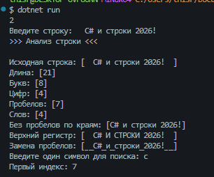

# Практическая работа №19
Автор: Волков Борис
Группа: ИСП-252
## Тема
Строки в C#.
## Что реализовано
- определение длины строки;
- подсчёт букв, цифр, пробелов и слов;
- поиск первого индекса символа;
- удаление пробелов по краям;
- перевод в верхний регистр;
- замена пробелов на подчёркивания.
## Короткие ответы
1. Чем отличаются `string` и `char`?
Ответ: string для строк, char для символА
2. Почему вызов `text.Trim()` без сохранения результата не меняет `text`?
Ответ: Потому что строки в C# неизменяемы
3. Зачем при разделении строки используется `RemoveEmptyEntries`?
Ответ: Чтобы исключить пустые части (т.е. пробелы)
## Результат

